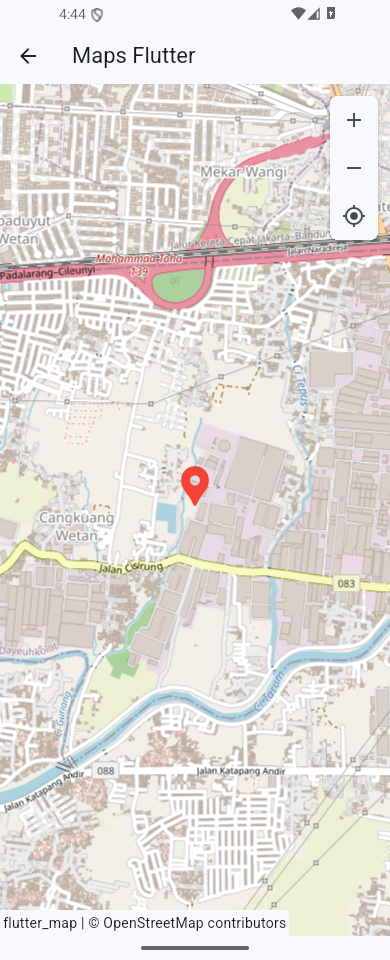

# Tugas_Pemob_Gmaps

Tugas pemrograman mobile menggunakan Flutter dan OpenStreetMap. Aplikasi menampilkan peta, marker lokasi, dan informasi lokasi saat marker diketuk.

OpenStreetMap digunakan melalui paket `flutter_map`, sehingga aplikasi tidak memerlukan API key Google. Koneksi internet diperlukan untuk memuat peta.

## Fitur

- Menu untuk membuka peta.
- Peta yang bisa digeser dan diperbesar atau diperkecil.
- Tombol untuk kembali ke lokasi awal.
- Pin lokasi dengan nama dan alamat.
- Navigasi kembali ke halaman utama.

## Menjalankan aplikasi

Proyek ini diuji dengan Flutter **3.47.5** dan Dart **3.13.4**.

```powershell
git clone https://github.com/Geonama/Tugas_Pemob_Gmaps.git
cd Tugas_Pemob_Gmaps
flutter pub get
flutter run -d edge
```

Untuk Android, nyalakan emulator atau sambungkan HP dengan USB debugging, kemudian jalankan:

```powershell
flutter devices
flutter run -d ID_PERANGKAT
```

Ganti `ID_PERANGKAT` dengan ID dari `flutter devices`.

## Membuat APK

```powershell
flutter build apk --debug
```

APK tersimpan di `build/app/outputs/flutter-apk/app-debug.apk`.

## Struktur kode

| File | Kegunaan |
| --- | --- |
| `lib/main.dart` | Menjalankan aplikasi dan mengatur tema |
| `lib/halaman_home.dart` | Menu utama dan navigasi |
| `lib/halaman_maps.dart` | Peta, marker, informasi lokasi, dan tombol zoom |

Posisi awal mengikuti contoh tutorial: `-6.9720791, 107.6053966`, dengan zoom `15`. Nama marker adalah **Telkom University**, dengan keterangan **Jl. Telekomunikasi Bandung**.

## Pemeriksaan

```powershell
flutter analyze
flutter test
```

## Tampilan



Referensi: [Belajar Flutter Episode 5](https://www.youtube.com/watch?v=68GrqWaQilk).

Data peta: [OpenStreetMap contributors](https://www.openstreetmap.org/copyright).
